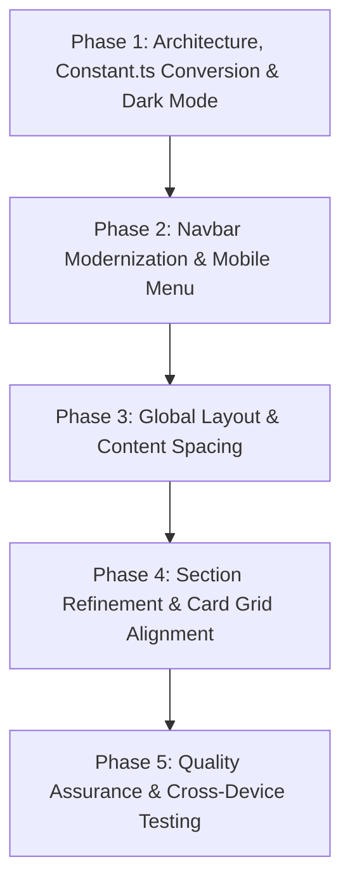

# Implementation Plan: Navbar & Content Placement Overhaul

## 1. Context & Objectives
This implementation plan addresses the layout, CSS, and navigation defects across the portfolio application. All proposed changes strictly comply with the coding standards, responsive design rules, and code quality conventions outlined in [`.claude/`](./.claude).

**Core Data Guarantee**: All visible portfolio content (Introduction, Technologies, Achievements, Experiences, Projects, Mini Projects, Site Config, and Footer information) will strictly remain centralized in `src/constants/Constant.ts`.

---

## 2. Standards Compliance Checklist (from `.claude/`)

| Rule Category | Standard in `.claude/` | Application in this Task |
| :--- | :--- | :--- |
| **TypeScript Strictness** | No `any`, `import type` for type-only imports (`verbatimModuleSyntax`), interface names prefixed with `I` | Ensure clean typing for all navigation items, layout props, and event handlers. |
| **Constants & Data Preservation** | Centralized data files, convert `Constant.tsx` to pure `.ts` | Convert JSX icons in `Constant.tsx` to `React.createElement` so it is a pure `.ts` file without breaking module imports or consuming components. |
| **Import Paths** | Use `@/` alias for all `src/` imports; no deep relative paths (`../../`) | Normalize all component, asset, and layout imports to `@/`. |
| **Styling & Theming** | Tailwind v4 utilities only, no inline `style={{}}`, no dynamic class construction, tokens in CSS (`globals.css`) | Manage glassmorphism, responsive grid columns, and dark mode palette via standard Tailwind classes and tokens. |
| **Responsive Design** | Touch targets $\ge 44\times44\text{px}$, dynamic viewport units (`dvh`), zero horizontal scroll overflow, fluid grid (`grid-cols-1 sm:grid-cols-2 lg:grid-cols-3`) | Ensure mobile navbar toggle and links meet tap target requirements, eliminate flex squishing in the technologies section, and prevent body scroll overflow. |
| **Prohibited Patterns** | No `console.log`, no inline styles, no unkeyed list items, no unused imports/variables | Clean up duplicate keys, remove unused symbols, and ensure clean build output. |

---

## 3. Root Cause Analysis

### 3.1 Navbar Bugs
1. **Transparent / Bleed-Through Header**:
   - `<HeroUINavbar>` has `fixed w-full bg-black/70 backdrop-blur-md`, but internal HeroUI wrappers lack solid backing. Scrolled content (text, cards, images) renders visibly beneath the navbar text, destroying contrast and legibility.
2. **Mobile Screen Overflow & Crowded Header**:
   - At screen widths $\le 640\text{px}$, the brand logo, LinkedIn icon, GitHub icon, notification bell, and hamburger toggle are all packed horizontally into the navbar.
   - On small phones ($360\text{px} - 420\text{px}$), this forces horizontal wrapping and pushes the hamburger toggle off the screen edge.
   - `NotificationIcon` is not wrapped in a `NavbarItem`, breaking flexbox alignment.
3. **Logo Sizing & Misalignment**:
   - Logo image uses `h-20 w-20` ($80\text{px}$), exceeding standard navbar height ($\sim 64\text{px}$), stretching navbar items and causing vertical imbalance.
4. **Active Route Indication**:
   - Navigation links have static gradient styling with no visual cues indicating the current page (`/`, `/projects`, `/contact`).

### 3.2 Content Placement & Layout Bugs
1. **Main Container Spacing (`layout.tsx`)**:
   - `<main>` has no top padding (`pt-20 sm:pt-24`) to account for the `fixed` navbar. Pages attempt to compensate with arbitrary margins (`mt-16`, `mt-20`), leading to inconsistencies across routes.
   - `<main>` has `border-2 border-b-white`, creating an unwanted border around the entire viewport.
2. **Forced Redirect Bug (`App.tsx`)**:
   - `App.tsx` contains `useEffect(() => { navigate("/") }, [])`, which hijacks direct visits or page refreshes on `/projects` and `/contact` and redirects them back to `/`.
3. **Hero Section Layout (`Index.tsx`)**:
   - DOM order places the profile image before introductory text, resulting in mobile screens displaying a huge photo before the introduction.
   - Headings mix disparate text alignments (`text-center`, `text-start`, `sm:pl-8`), creating jarring visual breaks.
4. **Technologies Grid Squishing (`Technologies.tsx`)**:
   - 5 categories are forced into a single flex row (`md:flex-row`), crushing cards into illegible vertical slivers between $768\text{px}$ and $1200\text{px}$.
5. **Card Height Discrepancies (`Projects.tsx`, `Achievements.tsx`)**:
   - Variable content lengths cause "View Project →" links to float at mismatched vertical positions across grid rows.
   - Grammatical typo in header: `"My Mini Project's"` $\rightarrow$ `"My Mini Projects"`.
6. **Dark Mode & Contrast Configuration**:
   - `index.html` lacks `class="dark"`, causing HeroUI components (inputs, modals, drawer) to default to light theme tokens against black backgrounds.

---

## 4. Phased Implementation Steps



### Phase 1: Architecture, `Constant.ts` Conversion & Dark Mode Configuration
- **File:** `src/constants/Constant.tsx` $\rightarrow$ `src/constants/Constant.ts`
  - Convert JSX elements in `Constant.tsx` (e.g., `<FaGlobe className="..." />`) to `React.createElement(FaGlobe, { className: "..." })`.
  - Rename file to `Constant.ts` (pure TypeScript).
  - All existing imports (`import { ... } from "@/constants/Constant"`) resolve automatically without changing file paths.
  - All data structures remain 100% intact and centralized.
- **File:** `index.html`
  - Add `class="dark"` and `bg-black text-foreground antialiased selection:bg-cyan-500 selection:text-black` to `<html>` and `<body>`.
- **File:** `src/App.tsx`
  - Remove the forceful redirect `useEffect(() => { navigate("/") }, [])` so direct route access and page refreshes work properly.
- **File:** `src/styles/globals.css`
  - Configure smooth scrolling, dark background defaults, and custom scrollbar styling compliant with Tailwind v4.

---

### Phase 2: Navbar Overhaul (`src/components/navbar/Navbar.tsx`)
- **Opaque Glassmorphism Background:**
  - Update `classNames` on `<HeroUINavbar>`:
    ```tsx
    classNames={{
      base: "fixed top-0 z-50 w-full bg-neutral-950/90 backdrop-blur-xl border-b border-neutral-800/80 shadow-lg transition-all",
      wrapper: "max-w-7xl px-4 sm:px-6 lg:px-8 h-16",
    }}
    ```
- **Logo Sizing:**
  - Adjust logo dimensions to `h-10 w-auto object-contain` with clean vertical centering.
- **Desktop Navigation Links (`lg:flex`):**
  - Implement active route detection via `useLocation().pathname`.
  - Active links receive a vibrant gradient and subtle underline indicator; inactive links maintain muted, readable hover transitions.
- **Mobile Header Reorganization (`lg:hidden`):**
  - Streamline mobile header to display only essential items: Logo on the left; Notification Bell and Hamburger Menu Toggle on the right.
  - Move LinkedIn and GitHub social links into the mobile menu drawer to prevent header overcrowding.
- **Mobile Menu Drawer (`NavbarMenu`):**
  - Apply `bg-neutral-950/95 backdrop-blur-2xl border-b border-neutral-800 pt-6 pb-8 px-6`.
  - Ensure links have $\ge 44\text{px}$ touch targets with icons and active highlights.
  - Include quick-access social links and copyright at the bottom of the drawer.

---

### Phase 3: Layout Structure & Uniform Content Padding
- **File:** `src/layouts/layout.tsx`
  - Remove `border-2 border-b-white` from `<main>`.
  - Set `<main className="flex-grow w-full max-w-7xl mx-auto px-4 sm:px-6 lg:px-8 pt-24 pb-16 min-h-[calc(100dvh-4rem)]">`.
  - Wrap in `<div className="flex flex-col min-h-dvh bg-black text-white selection:bg-cyan-500/20">`.
- **File:** `src/components/footer/footer.tsx`
  - Replace invalid empty fragments with typed wrappers and `key` props.
  - Add top border divider `border-t border-neutral-800/80` and comfortable vertical padding (`py-8`).

---

### Phase 4: Page Content Placement & Grid Realignment
- **File:** `src/Modules/details/introduction/Index.tsx`
  - Remove ad-hoc `mt-16` classes.
  - Reorder responsive flow: On mobile, text intro appears before the portrait; on desktop (`lg:flex-row`), portrait sits elegantly on the right.
  - Constrain image container (`max-w-xs sm:max-w-sm md:max-w-md`) with rounded-2xl border and subtle backlight glow.
- **File:** `src/Modules/details/technologiesKnow/Technologies.tsx`
  - Replace `flex-col md:flex-row` with responsive CSS grid:
    ```tsx
    <div className="grid grid-cols-1 sm:grid-cols-2 lg:grid-cols-3 xl:grid-cols-5 gap-6 mt-8">
    ```
  - Standardize category cards with equal height (`h-full`), dark glass styling, and smooth hover elevation.
- **File:** `src/Modules/WorkandExperience/project/Projects.tsx`
  - Remove redundant `mt-20`.
  - Make project cards flex-column (`flex flex-col justify-between h-full bg-neutral-900/40 border border-neutral-800 hover:border-cyan-500/50 rounded-2xl p-6`).
  - Pin the "View Project →" link to the bottom for consistent alignment.
- **File:** `src/Modules/WorkandExperience/experience/Experience.tsx`
  - Replace `min-h-screen` with natural section padding (`py-16`).
  - Add missing `key` prop on `<ProjectTechs>`.
- **File:** `src/Modules/details/contact/Contact.tsx`
  - Remove conflicting `min-h-screen pt-0` so the contact container centers naturally within the layout.
  - Style input fields with dark mode contrast and smooth focus rings.

---

## 5. Verification & Validation Plan

### Automated Checks
- Run TypeScript build check:
  ```powershell
  cmd /c npm run build
  ```
  *Requirement: Zero TypeScript errors, zero unused variable warnings, zero build errors.*

### Browser Validation (`browser_subagent`)
1. **Desktop Viewport ($1536 \times 730$)**:
   - Scroll page: verify background opacity ensures zero content bleed-through behind the navbar.
   - Click navigation links: verify smooth transitions and active state updates without full page reloads.
2. **Mobile Viewport ($375 \times 667$ & $400 \times 800$)**:
   - Verify header layout: logo on left, bell & hamburger toggle on right with comfortable tap margins ($\ge 44\text{px}$).
   - Click hamburger menu: verify drawer slides smoothly, displays navigation links and social icons cleanly, and closes on item click.
3. **Cross-Route Checks**:
   - Directly navigate to `/projects` and `/contact` to confirm route persistence without unwanted redirection to `/`.
